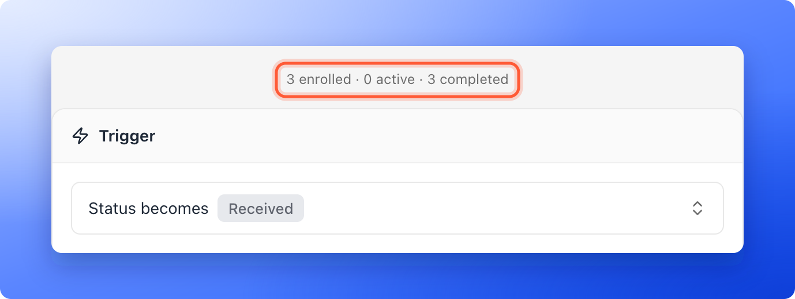
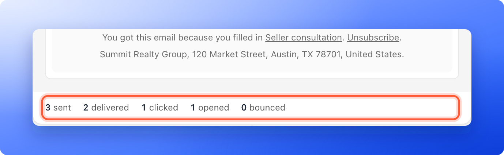
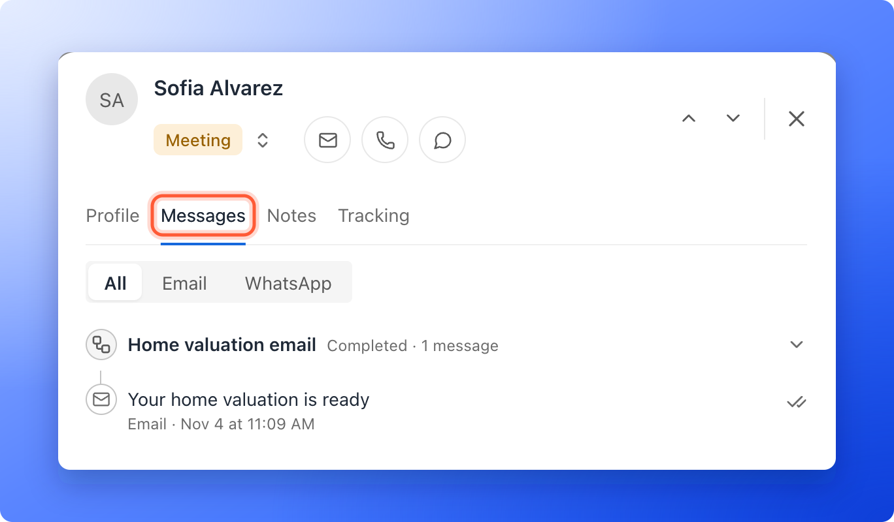

<Callout icon="star" color="#155DFC">
  Available on: **all plans** (Starter, Growth, Scale and Enterprise).
</Callout>

Once your flow is live, every email in it shows how it is doing: how many were sent, how many arrived, how many got clicked and opened, and how many bounced. A bounce is an email that could not be delivered. You can also open one lead and see exactly what happened to the messages sent to them. This page explains each number, how to turn on clicks and opens, and what your recipients see at the bottom of every email.

With the results, you can:

- **Check that your emails arrive.** Compare **sent** with **delivered**.
- **See what gets attention.** **clicked** and **opened** show which emails your leads act on.
- **Spot problems early.** A growing **bounced** count points to wrong addresses.
- **Follow one lead.** See each message, whether it arrived and what the lead did with it.

**Before you start**, you need:

- A flow that is published and has sent at least one email. See [Send automated emails to new leads](/messages/automated-emails).
- A role that can edit funnels to see the counts in the flow: Global Admin, Workspace Admin or Content Editor.
- A role that can see leads to see one lead's history: Global Admin, Workspace Admin or Contacts Manager.

## Important to note

<Warning>
  - **clicked** and **opened** only count when tracking is on for your sender's domain. Without it they stay at zero or do not show. See [Turn on click and open tracking](/messages/custom-sender-email#turn-on-click-and-open-tracking).
  - **clicked** and **opened** count emails, not clicks. An email that was opened five times counts once.
  - Open counts are not exact. They use an invisible image, and some mail apps, such as Apple Mail, load it even when nobody opens the email.
  - Numbers update as delivery reports come in, so a new email can show **sent** first and **delivered** a little later.
</Warning>

## Read the results in your flow

<Steps>
  <Step title="Open your flow">
    1. In the sidebar, click **Funnels** and open your funnel. Click **Edit funnel** in the funnel's menu.
    2. At the top, next to the funnel's name, click the **Funnel** button and choose **"Flows"**.
    3. Choose your flow in the **Flows** list on the left.

    Above the **Trigger** card, a line shows how many leads went through the flow, for example **3 enrolled · 0 active · 3 completed**.

    
  </Step>
  <Step title="Read the line under each email">
    At the bottom of each email card you see its counts, for example **3 sent**, **2 delivered**, **1 clicked**, **1 opened** and **0 bounced**. Before the first send, the line says **No sends yet**. If **bounced** is above zero, it turns red. **opened** shows only when open tracking is on.

    
  </Step>
  <Step title="Turn on tracking for clicks and opens (optional)">
    If **clicked** stays at zero, or **opened** is missing, click tracking or open tracking is off. In the sidebar, click **Settings**, then **Senders**. Open your domain and turn on **Click tracking**. After that, an **Open tracking** switch appears. The full steps are in [Add and verify a sender email](/messages/custom-sender-email#turn-on-click-and-open-tracking). **opened** shows once open tracking is on for any domain of your workspace.
  </Step>
  <Step title="Check one lead">
    Open the lead from your funnel's **Leads** page and click the **Messages** tab. It lists every flow the lead is in, newest first, with the flow's state and the messages it sent.

    

    - **The switch** at the top shows **All**, **Email** or **WhatsApp** messages. A flow that has finished is one folded row, such as **Completed · 1 message**. Click it to open it.
    - **The flow's state** is **Running**, **Waiting**, **Paused**, **Completed**, **Failed**, **Stopped** or **Not started**. A paused flow says why, for example **Your free trial can send 100 emails a day. Sending continues tomorrow.** See [Email limits and paused sequences](/messages/automated-emails#email-limits-and-paused-sequences).
    - **Each message** shows its subject, the channel and when it was sent. A mark at the end of the row says how far it got. Hover over it for its word: **Sent**, **Delivered**, **Opened** or **Clicked**.
    - **A problem keeps its word:** **Bounced**, or **Bounced (temporary)** when the problem may pass, **Marked as spam** when the person reported your email, or **Failed**.
    - **Waits** show as **Wait 1 day**, with **In 23 hours** while the lead is waiting and **Done** after.
    - **Messages that did not go out** are grey. **Next** marks the one that goes next. **Skipped** says why: **More than 3 days late**, **Did not tick email updates**, **No phone number**, **Said stop** or **Got this flow in the last 24 hours**. **Not sent** means the flow stopped before that message.
    - **A flow that stopped** says **Stopped** and who answered, for example "Sofia replied at 10:14 AM", or "your team replied".
    - **A paused flow that is on hold to protect your sending** says **Too many emails bounced** or **Too many emails were marked as spam**. See [Keep your emails out of spam](/messages/email-deliverability).
  </Step>
</Steps>

## What each count means

| Count | What it means |
|---|---|
| **sent** | Every email AskFunnel sent for this message. It includes the emails counted in the next lines. |
| **delivered** | The recipient's mail server accepted the email. |
| **clicked** | Emails where the lead clicked a link at least once. |
| **opened** | Emails that were opened at least once. Only shows when open tracking is on. |
| **bounced** | Emails that could not be delivered, for example because the address does not exist. |

An email the recipient marked as spam counts in **sent**, and the lead's history shows **Marked as spam**.

## What your recipients see

At the bottom of every email, your leads see:

- A small **AskFunnel** badge, unless you turned **Branding** off on the Growth plan or above. See [Remove the Made with AskFunnel branding](/funnel-settings/remove-branding).
- The line **You got this email because you filled in** and your funnel's name, which links to your funnel, followed by **Unsubscribe**.
- The line with your business name and your business address.

These lines cannot be removed, because email rules require them. Set your business address under **Settings**, **General**, **Business address**.

When a lead clicks **Unsubscribe**, a page asks **Unsubscribe from these emails?** with an **Unsubscribe** button, and then confirms **You are unsubscribed**. Some mail apps also show their own unsubscribe button, which works in one click. From then on, AskFunnel sends no more emails from your workspace to that address, from any flow. Addresses that bounced or reported your email as spam are also skipped.

## How do I know it is working?

- After the first send, the line under the email shows numbers instead of **No sends yet**.
- **delivered** is close to **sent**.
- A lead's **Messages** tab shows the email with a **Delivered** mark.

## Troubleshooting

<AccordionGroup>
  <Accordion title="I see No sends yet">
    Your flow is published but no lead has reached its trigger status since then. Leads that already had that status when you published are not added. See [Send automated emails to new leads](/messages/automated-emails).
  </Accordion>
  <Accordion title="I do not see any numbers under my emails">
    The numbers only show for a flow that has been published at least once. Click **"Publish"**, and check that your role can edit funnels.
  </Accordion>
  <Accordion title="clicked is always 0">
    Click tracking is off for your sender's domain, the email has no links, or nobody clicked yet. Turn on **Click tracking** under **Settings**, **Senders**.
  </Accordion>
  <Accordion title="opened does not show">
    **opened** only appears when **Open tracking** is on for one of your sender domains. It can also be switched on only after click tracking is active. See [Add and verify a sender email](/messages/custom-sender-email#turn-on-click-and-open-tracking).
  </Accordion>
  <Accordion title="delivered is lower than sent">
    Some emails have not been confirmed yet, or they bounced. Check again after a few minutes. If **bounced** is above zero, open the leads whose **Messages** tab shows **Bounced** and fix or delete those addresses.
  </Accordion>
  <Accordion title="Opens look too high">
    Some mail apps, such as Apple Mail, load the tracking image without anyone reading the email. Use **clicked** as the more reliable number.
  </Accordion>
  <Accordion title="A lead's flow says sending is on hold">
    AskFunnel put sending on hold to protect your sender reputation. See [Keep your emails out of spam](/messages/email-deliverability).
  </Accordion>
  <Accordion title="Can I remove the unsubscribe line?">
    No. The reason line with **Unsubscribe**, and the line with your business address, are required for email, so they always appear.
  </Accordion>
</AccordionGroup>

## What to do next

<Columns cols={3}>
  <Card title="Keep your emails out of spam" icon="shield-halved" href="/messages/email-deliverability">
    Help every email reach the inbox.
  </Card>
  <Card title="Add and verify a sender email" icon="at" href="/messages/custom-sender-email">
    Set up your sender and turn on tracking.
  </Card>
  <Card title="Send a series of follow-up emails" icon="hourglass-half" href="/messages/email-sequences">
    Add delays and more emails to your flow.
  </Card>
</Columns>

Need help? Email [support@askfunnel.com](mailto:support@askfunnel.com).
