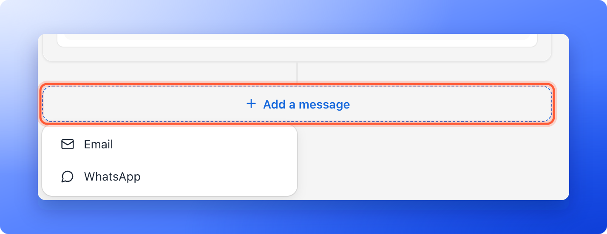
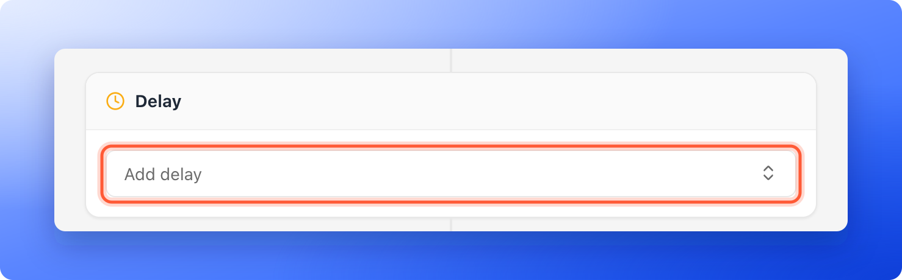
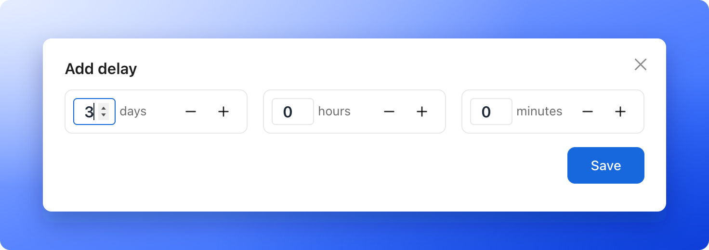

<Callout icon="star" color="#155DFC">
  Available on: **the Growth plan and above**. On Starter, a flow can send one email. Choosing **Email** under **"Add a message"** when a Starter flow already has an email opens an upgrade prompt.
</Callout>

Send several emails with a wait between them, for example a welcome email now, a reminder after a day and an offer after three days. One email is often not enough. You build a sequence in the same flow editor you use for a single email.

**Before you start**, you need:

- A flow with a trigger and a first email. See [Send automated emails to new leads](/messages/automated-emails).
- A verified sender. See [Add and verify a sender email](/messages/custom-sender-email).

## Important to note

<Warning>
  - A lead goes through a flow once. If their status returns to the trigger status later, they do not start again.
  - Edits to a live flow need a new publish. Click **"Publish"** again. Leads already in the flow finish with the version they started on.
  - Every email counts toward your monthly allowance and your daily limit, or on a free trial toward its 300 emails in total and 100 a day. When a limit is reached, the sequence pauses and the emails wait. They are not lost. An email that waits more than 3 days is skipped, and the flow moves on. See [Email limits and paused sequences](/messages/automated-emails#email-limits-and-paused-sequences).
  - A sequence with more than one email needs the Growth plan or above. If your plan moves below it, the sequence still sends its first email, and the other emails wait until you upgrade. See [Email limits and paused sequences](/messages/automated-emails#email-limits-and-paused-sequences).
</Warning>

## Build a sequence

<Steps>
  <Step title="Add the next message">
    Click **"Add a message"** below your last message and choose **Email**. AskFunnel adds a **Delay** card and a new email card after it.

    
  </Step>
  <Step title="Set the delay">
    Click the **Delay** card above the new email. It says **Add delay** until you set it, and **Wait 3 days** or similar afterwards.

    

    1. In the window, enter the wait in **days**, **hours** and **minutes**. You can type a number or use the minus and plus buttons.
    2. Click **"Save"**.

    

    The wait starts when the step before it finishes. So a delay before your first email counts from the moment the lead reaches your trigger status, and a delay before the second email counts from when the first was sent. Leave a delay empty to send straight away. The most you can enter is 365 days, 23 hours and 59 minutes.
  </Step>
  <Step title="Write the follow-up">
    Choose your sender under **From**, add a subject and write the message. Repeat **"Add a message"** for each step of the sequence. Use **"Send test"** to send yourself a copy of any email.
  </Step>
  <Step title="Publish the flow">
    Click **"Publish"** at the top right. Every new lead who reaches your trigger status now gets the whole sequence.
  </Step>
</Steps>

## Let AI write the sequence

A new flow with no message yet offers **Create a follow up with AI** under **Add a message**. Choose **Email** or **WhatsApp**. AskFunnel writes three messages with waits between them from your funnel's questions, and adds them to the flow as ordinary steps. It says **You review it before anything is sent.**

- **Price:** each choice shows what it costs in AI credits. Nothing is charged until you choose one.
- **Not available:** a choice that cannot be used says why under the menu. **Email** needs the Growth plan or above, and **WhatsApp** needs a connected number. See [Connect your WhatsApp number](/messages/connect-whatsapp).
- **Sender:** if your workspace has exactly one verified sender, the emails use it. Otherwise choose one under **From** in each email.
- **Review and publish:** change anything you like, then click **"Publish"**. WhatsApp messages also need **Submit for review** first. See [Send WhatsApp messages from a flow](/messages/whatsapp-template).

If it cannot write, it says **Couldn't write the follow up. Try again.**

## Manage the steps

- **Reorder or remove a message:** click the three dots at the top right of a message (**Message actions**) and choose **Move up**, **Move down** or **Delete**.
- **Clear a delay:** open the delay and click **"Clear delay"**.
- **Stop the sequence when a lead moves on:** click the **Trigger** card, turn on **Remove leads when their status changes** and click **"Save"**. Converted or advanced leads then stop receiving the flow.
- **Turn the flow off:** click the arrow next to **Publish** and choose **"Unpublish"**. This stops it for everyone. Leads waiting for their next email will not get it.

<Tip>
  Turn on **Remove leads when their status changes** for any sequence that sells or follows up, so a lead you already moved to **Meeting** or **Converted** does not keep getting emails.
</Tip>

## What to do next

<Columns cols={2}>
  <Card title="Keep your emails out of spam" icon="shield-halved" href="/messages/email-deliverability">
    Help every email in your sequence reach the inbox.
  </Card>
  <Card title="Email your team when a lead arrives" icon="bell" href="/messages/team-alerts">
    Get an alert the moment a lead submits.
  </Card>
</Columns>

Need help? Email [support@askfunnel.com](mailto:support@askfunnel.com).
