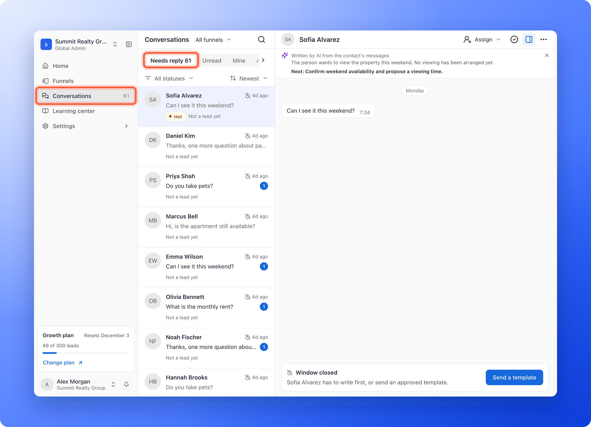
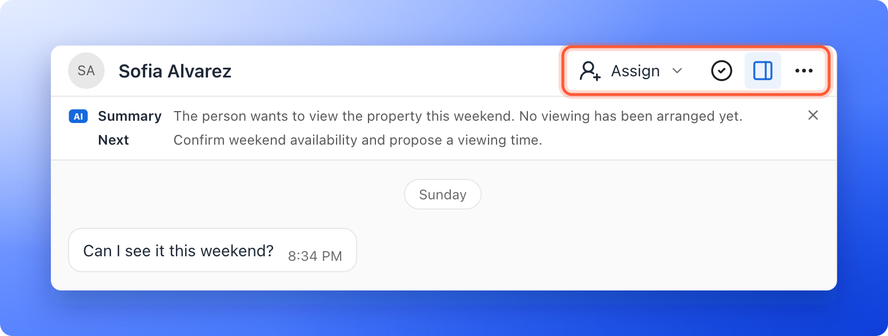
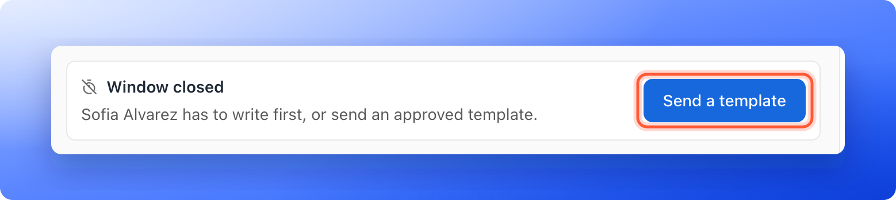
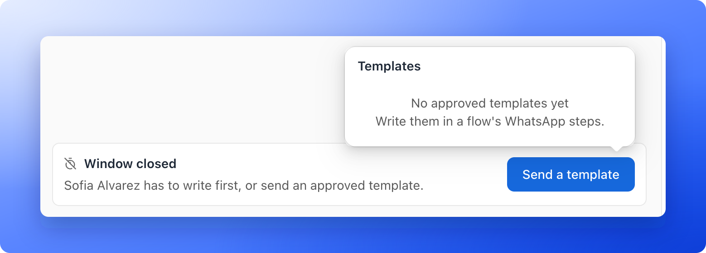

<Callout icon="star" color="#155DFC">
  Available on: **the Growth plan and above**, for Global Admins, Workspace Admins and Contacts Managers. You also need a connected WhatsApp number. See [Connect your WhatsApp number](/messages/connect-whatsapp).
</Callout>

Conversations is your WhatsApp inbox. Every chat on your workspace's WhatsApp number is here: leads who answer a message from one of your flows, and people who write to your number first. You see which chats are waiting for a reply, answer them, hand them to a teammate and mark them done.

**Before you start**, you need:

- A connected WhatsApp number for the workspace. If there is none, the page says **No chats yet** and shows **Connect WhatsApp** to admins. Everyone else reads **Ask an admin to connect WhatsApp.**
- A role that works with leads. The **Conversations** row is only in the sidebar for Global Admins, Workspace Admins and Contacts Managers.

## Open Conversations

In the sidebar, click **Conversations**. A number at the end of the row counts the chats that need a reply (it stops at 99+). On a phone, tap the chat button in the top bar. A dot on it means a chat needs a reply.

On a plan without WhatsApp, the page offers an upgrade instead. See [Upgrade your plan](/billing/upgrade).

On a computer the page has three parts: the **chat list** on the left, the open **chat** in the middle and the **lead** on the right. On a phone, you see one at a time and **Back to chats** takes you back to the list.

## Find a chat

The list has a row for each chat, with the person's name, the last message, how long ago it came and a blue count of unread messages.

- **Views:** **Needs reply** (chats where the lead wrote last and nobody has answered yet, unless you marked them done), **Unread**, **Mine** (chats assigned to you) and **All**. The number next to **Needs reply** is the one on the sidebar row.
- **Funnels:** the picker next to the title says **All funnels**. Pick one funnel, or up to 10, to see only their chats.
- **Lead status:** **All statuses** narrows the list to chats whose lead has the status you pick, such as **Contacted**.
- **Sort:** in **Needs reply**, sort by **Newest** or **Longest waiting**.
- **Search:** click the magnifier and type. **Search people and messages** looks at names and at the words in messages. Chats of locked leads aren't searched.

Small marks on a row tell you more:

- **Hot** (amber): the person looks ready to buy, book or meet soon.
- **Not a lead yet:** the person wrote to your number but has not filled in a funnel.
- **A crossed clock:** the window is closed. Hover for **Window closed. Send a template to restart.** An amber clock says how long free replies stay open, for example **Free replies close in 40 min**.
- **A check mark:** the chat is marked done.
- **Failed:** your last message did not go out.

The list shows the newest 300 chats.

## Read a chat

Click a chat to open it. The header has the person's name and four controls: **Assign**, a check mark for **Mark done**, **Lead details** and **More** (the three dots).

- **Summary:** a short note under the header, marked with the blue **AI** tile. **Summary** says what the person wants and **Next** says what to do next. Close it with the **X**, or hide and show it from **More**.
- **Messages:** photos, documents, locations and contacts show in the chat. Voice messages play in place. A file larger than 25 MB is not saved, and the chat says so.
- **Who sent it:** a small mark on your messages says **Sent by the Welcome flow** (or the flow's name), **Template message**, or **Sent from the WhatsApp app on the phone** when you wrote it in the WhatsApp Business app. Messages you wrote in that app before you connected the number are under **From your WhatsApp Business app**.
- **A flow about to message the lead:** a line above the reply box names the flow and says when it messages them, for example **Welcome flow messages them in 3 days**, with **View** to open the lead's messages.

## Reply

WhatsApp lets you answer for free during 24 hours after the lead's last message. The top of the reply box shows how long is left, for example **23 h left**. It turns amber when less than 2 hours remain.

In the reply box you can:

- **Type your message** (up to 4,096 characters). On a computer, **Enter** sends. On a phone, **Enter** starts a new line and the **Send** button sends.
- **Attach a file** with the paperclip. Photos can be JPG or PNG up to 5 MB. Documents can be PDF, Word, Excel, PowerPoint or text up to 8 MB. Add a **Caption** if you like.
- **Add an emoji** (on a computer).
- **Suggest reply**, marked with the blue **AI** tile, writes a draft from the chat for you to edit. The button with the **AI** tile, **Write with AI**, rewrites what you typed once the box has words: **Change tone** (**Friendlier**, **More formal**, **More confident**), **Make shorter**, **Fix spelling and grammar** or **Translate** into the lead's language or English, Spanish, French, Portuguese, German, Arabic, Hindi or Urdu. Both are free and never send by themselves. **Undo** brings your words back.
- **Templates** opens your approved templates, which you can send at any time.

Your message shows in the chat at once, then **Sending**, **Sent**, **Delivered** and **Read** as WhatsApp reports it. If it fails, the chat says **Failed** with the reason and **Send again**.

### When the window is closed

After 24 hours with no message from the lead, the reply box says **Window closed** and **Sofia Alvarez has to write first, or send an approved template.** Click **Send a template** to restart the chat.

The list shows the templates that Meta has approved. A marketing template is marked **Marketing**. Pick one and click **Send template**. Meta bills you for messages, as your number's page says.

If the list says **No approved templates yet**, write one in a flow's WhatsApp step and send it to Meta for review. See [Send WhatsApp messages from a flow](/messages/whatsapp-template).

### Start a chat with a lead

On a lead's panel, click the **WhatsApp chat** icon next to the email and call icons. It opens that lead's chat in Conversations. A lead who never wrote has no messages yet, and the reply box offers a template to send first. You can only do this for a lead who ticked **WhatsApp updates** in your form. Otherwise the box says **This lead did not tick WhatsApp updates for this number. You can message them after they write to you.**

A person who asked to stop shows **This contact asked to stop** and **You cannot message them on WhatsApp.**

## Work together

- **Assign a chat:** click **Assign** and pick a teammate. Search with **Search people**. The teammate gets the chat's notifications, and it shows under **Mine** for them. Choose **Unassign** to clear it.
- **Mark a chat done:** click the check mark. It leaves **Needs reply**. In **Needs reply** on a computer the button reads **Mark done and open the next chat**. **Reopen** brings it back, and a new message from the lead does too.
- **Open the lead:** **Lead details** shows the person next to the chat, with **Open lead** to see the whole record. Change the lead's status from the chat header.
- **Phone:** press and hold a chat in the list to see its actions.

Deleting a lead also deletes its WhatsApp chat.

## When the number needs attention

If Meta restricts the number or it must be connected again, a banner **WhatsApp needs attention** shows over the chats, with **Open settings** for admins. You can still read your chats. If you disconnect the number, the chats stay readable and say **This chat is with a number that is no longer connected. It stays here as history.**

## Troubleshooting

<AccordionGroup>
  <Accordion title="I do not see Conversations in the sidebar">
    The row is for Global Admins, Workspace Admins and Contacts Managers. Ask an admin to change your role. A Content Editor does not see it.
  </Accordion>
  <Accordion title="The page says No chats yet">
    Chats start when a lead replies or writes to your number. If the workspace has no number yet, an admin has to connect one. See [Connect your WhatsApp number](/messages/connect-whatsapp).
  </Accordion>
  <Accordion title="I cannot type a reply and the box says Window closed">
    The lead has not written for 24 hours. Send an approved template to restart the chat, or wait for the lead to write.
  </Accordion>
  <Accordion title="A message shows Failed">
    The chat says why, in plain words. Fix the cause, for example a number that is not on WhatsApp, and click **Send again**.
  </Accordion>
  <Accordion title="I see Couldn't load the chat">
    Click **Try again**, or reload the page. The chat list keeps working while a chat reloads.
  </Accordion>
</AccordionGroup>

## What to do next

<Columns cols={2}>
  <Card title="Send WhatsApp messages from a flow" icon="paper-plane" href="/messages/whatsapp-template">
    Write the messages your leads get automatically.
  </Card>
  <Card title="Connect your WhatsApp number" icon="plug" href="/messages/connect-whatsapp">
    Link your number through Meta.
  </Card>
</Columns>

Need help? Email [support@askfunnel.com](mailto:support@askfunnel.com).
