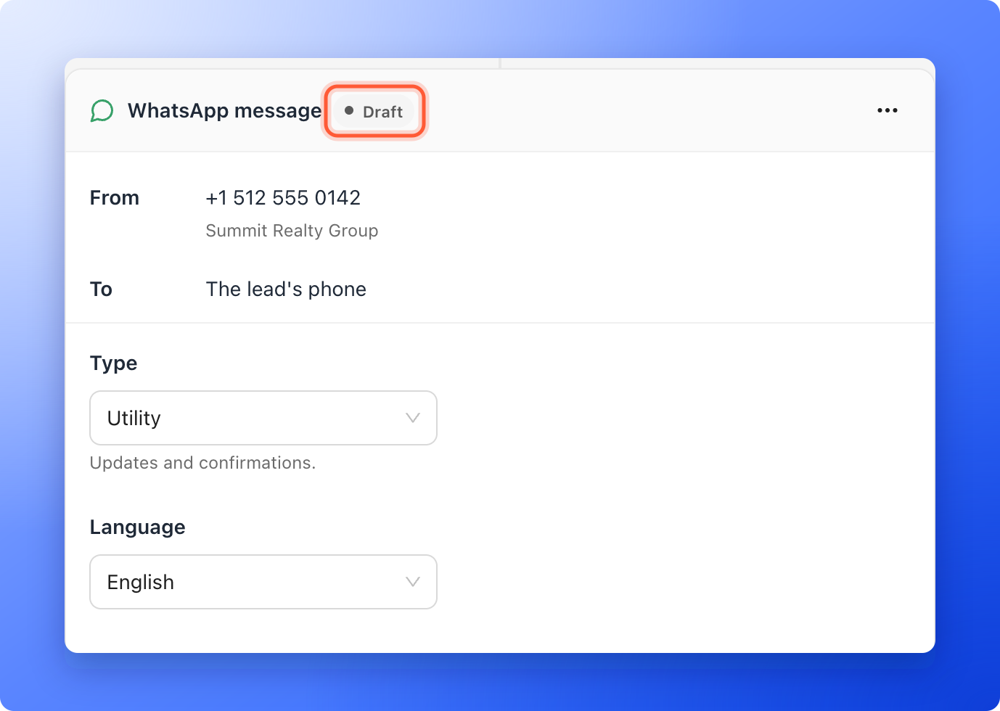
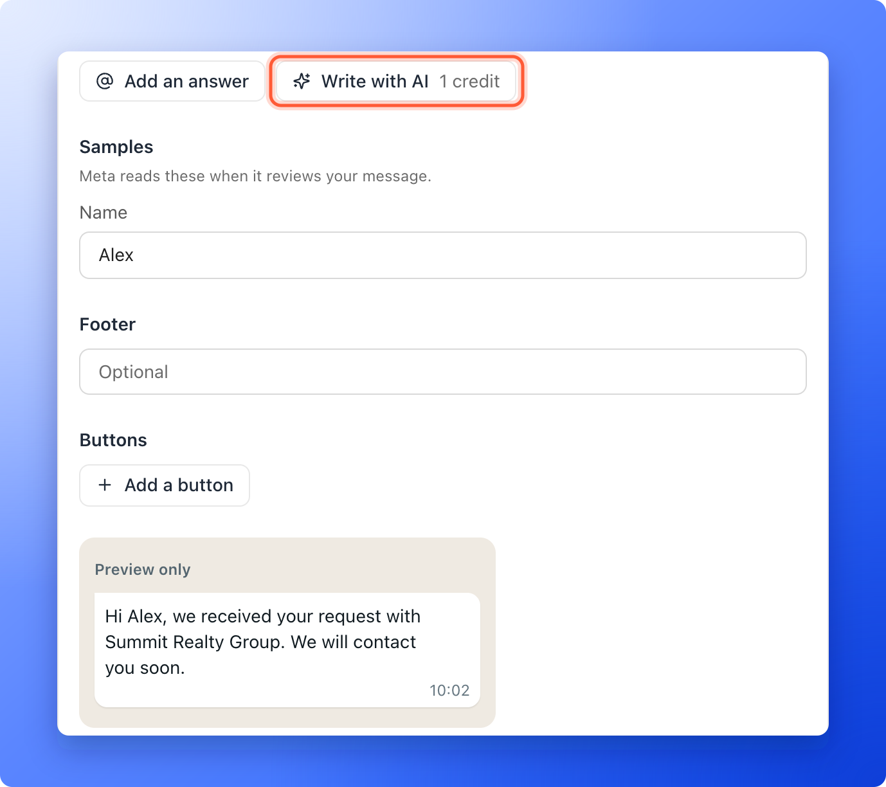

<Callout icon="star" color="#155DFC">
  Available on: **the Growth plan and above**, with a connected WhatsApp number. See [Connect your WhatsApp number](/messages/connect-whatsapp).
</Callout>

A flow can message your leads on WhatsApp as well as by email. A common use is a short confirmation sent the moment a lead completes your funnel, and a nudge a day later. WhatsApp requires every automatic message to be written ahead of time and approved by Meta, the company behind WhatsApp. These approved messages are called templates. You write the message in the flow, send it for review, and it sends once it is approved.

**Before you start**, you need:

- A connected WhatsApp number for the workspace. See [Connect your WhatsApp number](/messages/connect-whatsapp).
- A funnel whose form has a **Phone** field and a **Consent** field set to **WhatsApp updates**. That option is offered on plans with WhatsApp. A lead gets WhatsApp messages only if they tick that box.
- A flow for the funnel. See [Send automated emails to new leads](/messages/automated-emails) for how to open the flow editor and set the trigger.

## Important to note

<Warning>
  - Meta reviews each message before it can be sent. A review usually takes minutes and at most 24 hours. A flow cannot be published until each of its WhatsApp messages has been approved.
  - A lead is messaged only if they have a phone number and ticked **WhatsApp updates**. Otherwise the message is skipped for that lead.
  - A lead who answers with **Stop promotions**, or a stop word, is not messaged again until they opt in again.
  - Meta bills you for the messages you send. WhatsApp also limits how many promotional messages one person gets.
</Warning>

## Add a WhatsApp message

<Steps>
  <Step title="Add the message to the flow">
    In the flow, click **"Add a message"** and choose **WhatsApp**. A **Delay** card and a **WhatsApp message** card appear. Set the delay if the message should wait.

    The **WhatsApp** choice is grayed out when something is missing, and the menu says what: **Connect WhatsApp in workspace settings first**, or the plan that has WhatsApp with an **Upgrade** link.

    

    The card shows **From**, which is your number, and **To**, which is **The lead's phone**. Next to the title, a status says where the message stands with Meta. A message you are still writing is a **Draft**.
  </Step>
  <Step title="Choose the type and language">
    1. Under **Type**, choose **Utility** (updates and confirmations) or **Marketing** (offers and nudges). A marketing message gets a **Stop promotions** button added for you, so a lead can opt out in one tap.
    2. Under **Language**, choose the language you write in.

    If Meta files your message under a different type, the card says **Meta changed the type to** and the new one.
  </Step>
  <Step title="Write the message">
    Type your text under **Message**. It can be up to 1,024 characters.

    - **Add an answer** puts a lead's answer into the text, such as their name. The message then asks for a sample of each answer, under **Samples**. Meta reads the samples when it reviews your message.
    - **Write with AI** (1 credit) writes a message for your funnel. If the message already has words, AskFunnel asks **Replace your message?** first.
    - **Footer** is an optional line under the message, up to 60 characters.
    - **Buttons:** click **Add a button** and choose **Quick reply**, **Website** or **Call**. A button name can be up to 25 characters, and a message can have up to 10 buttons.

    A **Preview only** shows how the message will look. Your words save by themselves, and the card says **Saving** and then **Saved**.

    
  </Step>
  <Step title="Submit it for review">
    Click **"Submit for review"**. If the card shows warnings about what Meta would refuse, fix them first, because the button waits until they are gone. If you have several WhatsApp messages in the flow, a **Submit all for review** button at the end sends them all.

    The status turns to **In review**. Meta usually answers within minutes, at most 24 hours.
  </Step>
  <Step title="Publish the flow">
    When the status says **Approved**, click **"Publish"**. If a message is still **In review**, AskFunnel says **Your WhatsApp messages are waiting for Meta's approval. Publish once they are approved.** Nothing is wrong. Publish again once they are approved.
  </Step>
</Steps>

## What the status means

| Status | What it means |
|---|---|
| **Draft** | You are still writing, or you edited the message after Meta approved it. |
| **In review** | Meta is checking it. |
| **Approved** | Meta approved it. It can be sent. |
| **Rejected** | Meta did not approve it. The card shows Meta's reason in red. Click **Fix with AI** (1 credit) or edit the words yourself, then submit again. |
| **Paused** | Meta paused it because of low quality. Edit it and submit again. |
| **Disabled** | Meta disabled it. Write a new one. |

If you edit an approved message, leads still get the approved words until Meta approves your edit.

## Stop when the lead replies

When your workspace uses WhatsApp, the **Trigger** card has a switch, **Stop when the lead replies**. It says "A WhatsApp reply ends the flow for that lead." It is on in a new flow. A lead who answers on WhatsApp then gets no more messages from that flow, and you answer in [Conversations](/messages/whatsapp-conversations).

## Who gets the message

Open a lead and click the **Messages** tab to see what happened to each WhatsApp message: **Sent**, **Delivered**, **Read** or **Replied**. A message that did not go out is marked **Skipped** with the reason:

- **No phone number**
- **Did not tick WhatsApp updates**
- **Said stop**
- **WhatsApp could not deliver**
- **More than 3 days late**

If a lead answered a message with a stop, the row says **Said stop**.

## Troubleshooting

<AccordionGroup>
  <Accordion title="WhatsApp is grayed out in Add a message">
    Your workspace has no connected number, or your plan does not include WhatsApp. The menu says which. See [Connect your WhatsApp number](/messages/connect-whatsapp).
  </Accordion>
  <Accordion title="My message was rejected">
    Read Meta's reason on the card. Click **Fix with AI** or change the words, then click **Submit for review** again. If your message is promotional, choose **Marketing** as its type.
  </Accordion>
  <Accordion title="A lead's flow says Paused">
    The lead's **Messages** tab gives the reason. **Waiting for Meta to approve the message.** clears when Meta answers. **WhatsApp is not connected. Connect it again to resume.** means the number needs attention. **Meta paused this message. It sends again when Meta lifts the pause.** needs nothing from you. **Meta turned off this message. Edit it and submit it again to resume.** needs a new submission. **Meta is holding WhatsApp messages for now.** clears by itself.
  </Accordion>
  <Accordion title="The card says Not on your plan">
    A flow made on a higher plan kept its WhatsApp step after a downgrade. The card says which plan has WhatsApp, with an **Upgrade** link. You can move or delete the step, but you cannot publish the flow with it until you upgrade.
  </Accordion>
  <Accordion title="Leads do not get the message">
    Check that the lead has a phone number and ticked **WhatsApp updates**, that the flow is **Live**, and that the message is **Approved**. Your bell also shows **WhatsApp needs attention** if the number has to be connected again.
  </Accordion>
</AccordionGroup>

## What to do next

<Columns cols={2}>
  <Card title="Reply to leads on WhatsApp" icon="comments" href="/messages/whatsapp-conversations">
    Answer chats from one inbox.
  </Card>
  <Card title="Send a series of follow-up emails" icon="hourglass-half" href="/messages/email-sequences">
    Add delays and more messages to your flow.
  </Card>
</Columns>

Need help? Email [support@askfunnel.com](mailto:support@askfunnel.com).
