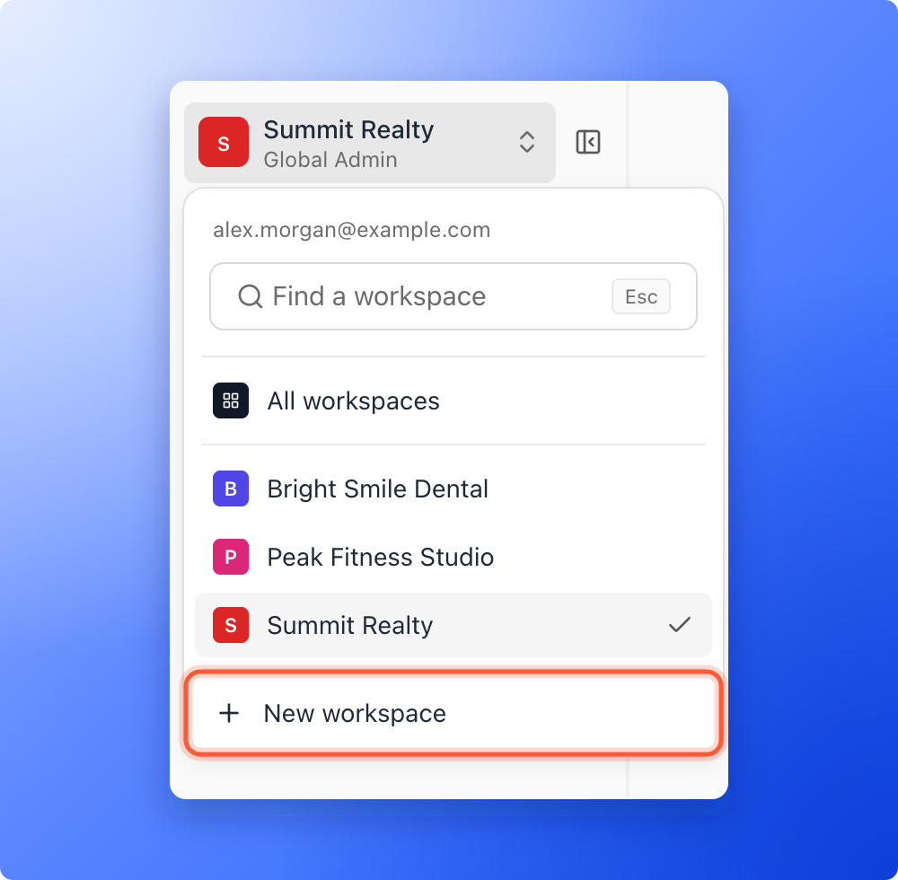
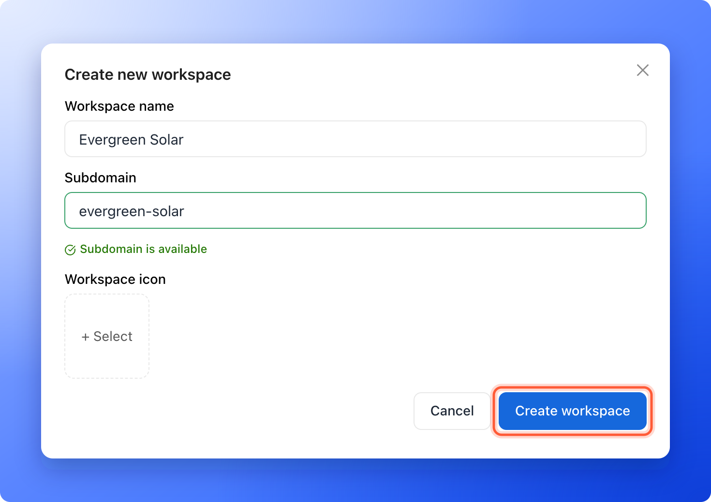

Create a separate workspace for each client or brand, so their funnels, leads and team stay organized. Every plan includes unlimited workspaces.

**Before you start**, you need:

- A Global Admin role. Only Global Admins can create workspaces. If you do not see the button, ask a Global Admin to create the workspace for you.

## Important to note

<Warning>
  - The subdomain is part of your funnel addresses. If you change it later, your funnels move to the new address and the old one stops working, so update any links you already shared.
  - Every workspace in your account shares the same plan limits for live funnels, leads, team seats and AI credits.
</Warning>

## Create a workspace

<Steps>
  <Step title="Open the workspace switcher">
    1. Click the workspace name at the top of the sidebar. On a phone, tap it in the bar at the top of the screen.
    2. Click **"New workspace"** at the bottom of the menu. If you have no workspaces yet, click **"New workspace"** on the page instead.

    
  </Step>
  <Step title="Fill in the details">
    1. **Workspace name:** Use a clear name, for example Evergreen Solar. It can be 2 to 60 characters.
    2. **Subdomain:** This is the address of your funnels, for example evergreen-solar.askfunnel.com. A subdomain is the first part of a web address. Use 3 to 20 lowercase letters, numbers or hyphens. You see **Subdomain is available** when the address is free.
    3. **Workspace icon:** Optional. Click **+ Select**, choose or upload an image, and click **"Select image"**. The icon helps you tell clients apart.

    

  </Step>
  <Step title="Create the workspace">
    Click **"Create workspace"**. The window closes and the new workspace shows in the switcher while it is being created. You see the message "Workspace created." and land on the new workspace's **Home**.
  </Step>
</Steps>

<Tip>
  To change the name, subdomain or icon later, open the workspace, click **Settings** in the sidebar, then **General**. When you change the subdomain, a window titled **Change the address?** shows the new address. Your funnels move to it, and the old address stops working but stays reserved for you for 30 days. If the workspace has custom domains, remove them before you change the subdomain.
</Tip>

## Troubleshooting

<AccordionGroup>
  <Accordion title="I do not see New workspace">
    Only Global Admins can create workspaces. Ask a Global Admin, or ask to be [promoted to Global Admin](/workspaces/give-access).
  </Accordion>
  <Accordion title="My subdomain is not accepted">
    A subdomain needs 3 to 20 characters: lowercase letters, numbers and hyphens. It cannot start or end with a hyphen, cannot have two hyphens in a row, and cannot be a reserved word. If you see "This subdomain is already taken", choose a different one.
  </Accordion>
  <Accordion title="The new workspace does not appear">
    It can take a moment. If it does not show in the workspace switcher after a minute, check for a message about a plan limit or a subdomain that is taken, then try again.
  </Accordion>
</AccordionGroup>

## What to do next

<Columns cols={3}>
  <Card title="Launch your first funnel" icon="flag-checkered" href="/getting-started/launch-your-first-funnel">
    Start building in your new workspace.
  </Card>
  <Card title="Invite a teammate or client" icon="envelope" href="/workspaces/give-access">
    Add your team or your client to the workspace.
  </Card>
  <Card title="Switch between workspaces" icon="right-left" href="/workspaces/switch-workspaces">
    Move between your clients' workspaces.
  </Card>
</Columns>

Need help? Email [support@askfunnel.com](mailto:support@askfunnel.com).
