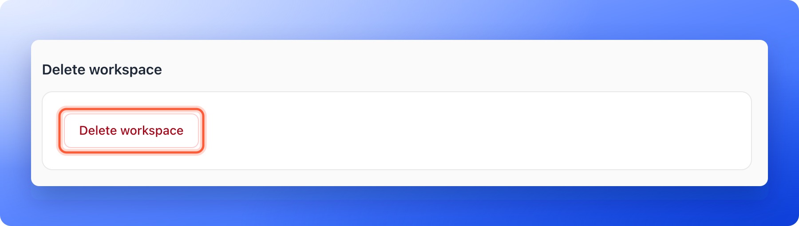
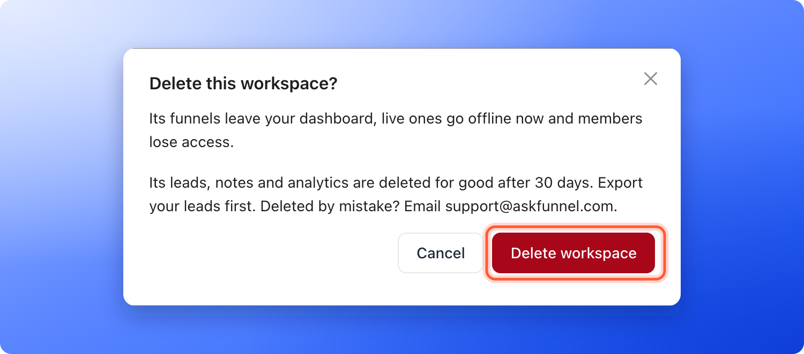

<Callout icon="star" color="#155DFC">
  Available to: **Global Admins**, on every plan.
</Callout>

Delete a workspace when a client has left or a brand has closed. The workspace disappears from the workspace switcher, its funnels leave your dashboard, its live funnels go offline and its team loses access to it. This page shows how to do it, what to do first and what to expect.

**Before you start**, you need:

- A Global Admin role. Only Global Admins see **"Delete workspace"**. Workspace Admins can open a workspace's settings and edit it, but not delete it.
- At least one other workspace. You cannot delete your last one.

## Important to note

<Warning>
  - There is no undo button in the app. The workspace's leads, notes and analytics are deleted for good after 30 days. If you delete a workspace by mistake, email [support@askfunnel.com](mailto:support@askfunnel.com) before then.
  - You can no longer open the workspace, its funnels or its leads in the dashboard. [Export your leads](/leads/export-contacts) first if you may need them.
  - Live funnels go offline right away, and visitors can no longer send leads through them. They stop counting toward your plan's live funnel limit.
  - Leads you already sent to other tools, such as HighLevel, Google Sheets or a webhook, stay there.
</Warning>

## What happens when you delete a workspace

- **The workspace disappears** from the workspace switcher right away.
- **Its funnels leave your dashboard.** Live funnels can no longer be opened at their AskFunnel address, and new visitors cannot leave a lead.
- **Its team loses access to it.** Global Admins keep their access to every other workspace. If this workspace was the only place where someone had a Workspace Admin or Content Editor role, their team seat is freed. See [How team seats work](/workspaces/team-seats).
- **Its WhatsApp number is disconnected,** if you had connected one.
- **Its subdomain is held for 30 days.** The subdomain is the first part of the workspace's web address. For 30 days only your organization can use it again, for example for a new workspace. After that it is free for anyone. See [Create a workspace](/workspaces/create-workspace).
- **Your other workspaces are not touched.** Their funnels, leads and teams stay as they are.

## Delete a workspace

<Steps>
  <Step title="Get ready">
    1. [Export your leads](/leads/export-contacts) from each funnel you may need later.
    2. Tell the people who use the workspace, such as a client, that it is going away.
  </Step>
  <Step title="Open the workspace's settings">
    1. Open the workspace you want to remove with the workspace switcher at the top of the sidebar.
    2. Click **Settings** in the sidebar, then **General**.
    3. Scroll to the bottom of the page. The last group is **Delete workspace**. Click **"Delete workspace"**.

    
  </Step>
  <Step title="Confirm">
    A window titled **Delete this workspace?** asks you to confirm. It tells you that the funnels leave your dashboard, live ones go offline now and members lose access, and that leads, notes and analytics are deleted for good after 30 days. Check that you picked the right workspace, then click **"Delete workspace"**. Click **"Cancel"** to keep it.

    

    You see **Workspace deleted.**
  </Step>
</Steps>

## How do I know it is working?

- You see **Workspace deleted.**, and the workspace is gone from the workspace switcher.
- The funnels of that workspace no longer open at their address.
- If you deleted the only place where a teammate had a seat, **Members** shows one less seat in use.

## Troubleshooting

<AccordionGroup>
  <Accordion title="I do not see Delete workspace">
    Only Global Admins see the **Delete workspace** group at the bottom of **Settings**, **General**. Ask a Global Admin, or ask to be promoted. See [Invite a teammate or client to a workspace](/workspaces/give-access).
  </Accordion>
  <Accordion title="I see You can't delete your last workspace">
    The message says **You can't delete your last workspace. Create another one first, or leave the organization if you want to shut things down.** Your account needs at least one workspace. Create another one first, then delete this one. See [Create a workspace](/workspaces/create-workspace).
  </Accordion>
  <Accordion title="I see You don't have permission to delete this workspace">
    Only Global Admins can delete workspaces. Ask a Global Admin to do it.
  </Accordion>
  <Accordion title="I see Couldn't delete the workspace">
    The delete did not go through. Try again in a minute. If it keeps happening, email support and tell us the name of the workspace.
  </Accordion>
  <Accordion title="I deleted a workspace by mistake">
    There is no undo button. Within 30 days, email [support@askfunnel.com](mailto:support@askfunnel.com) with the name and the subdomain of the workspace, and we can restore it with its funnels and leads. Its members need to be invited again, its funnels published again, and its integrations and its WhatsApp number reconnected. After 30 days its leads, notes and analytics are permanently deleted and cannot be restored.
  </Accordion>
</AccordionGroup>

## What to do next

<Columns cols={3}>
  <Card title="Create a workspace" icon="folder-plus" href="/workspaces/create-workspace">
    Add a workspace for a new brand or client.
  </Card>
  <Card title="Export your leads" icon="file-export" href="/leads/export-contacts">
    Keep a copy of your leads before you delete.
  </Card>
  <Card title="Switch between workspaces" icon="right-left" href="/workspaces/switch-workspaces">
    Open the workspace you want to work in.
  </Card>
</Columns>

Need help? Email [support@askfunnel.com](mailto:support@askfunnel.com).
