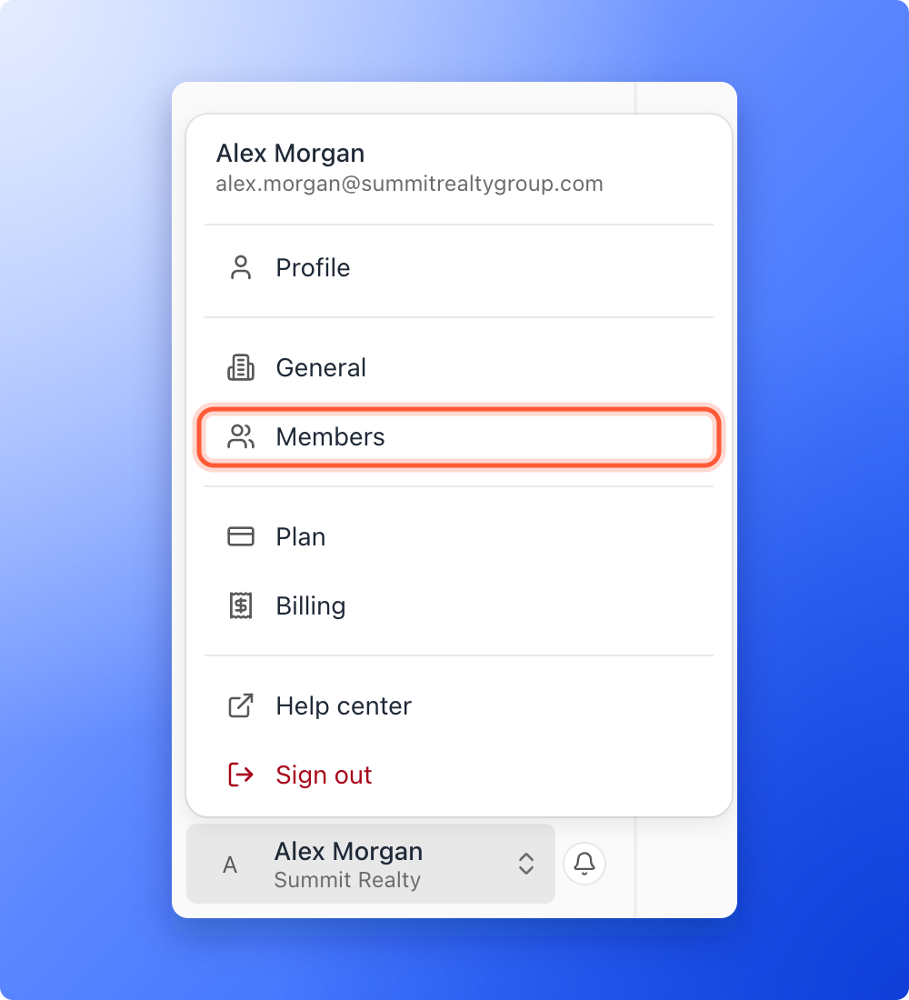
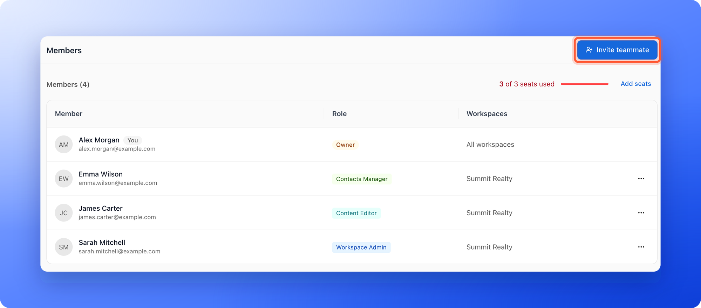
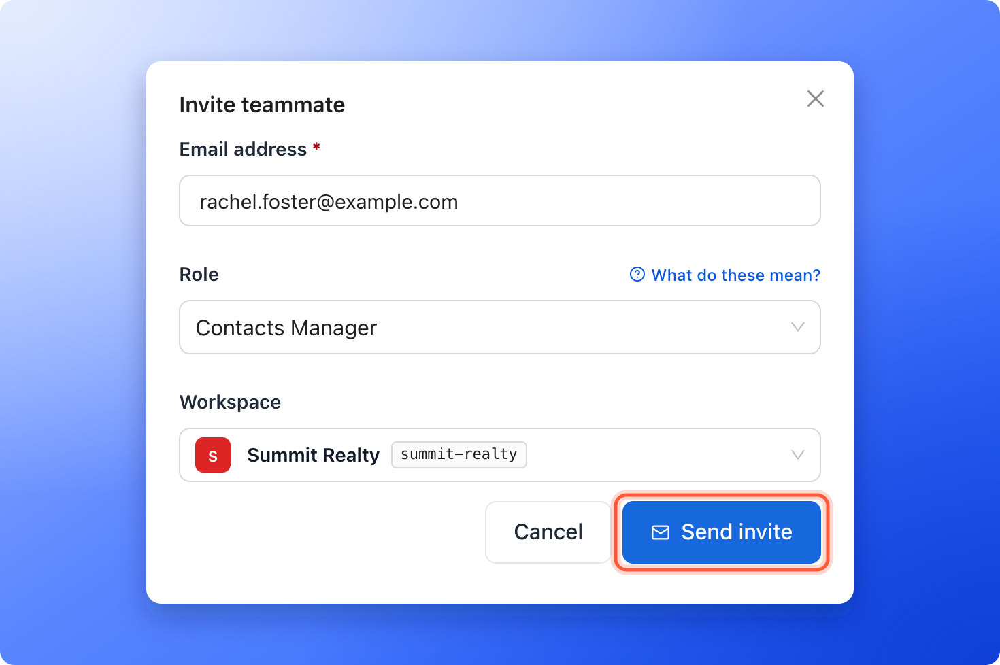
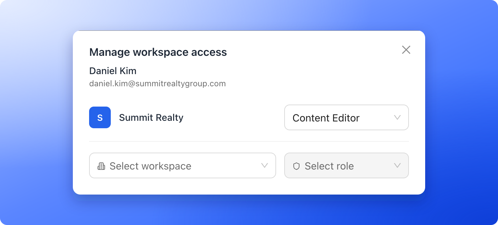

Invite a teammate, employee, partner or client by email. They get a link to join, and the role you pick decides what they can do.

**Before you start**, you need:

- A Global Admin role, or a Workspace Admin role for your own workspace. Only Global Admins can invite Global Admins. Workspace Admins can invite Workspace Admins, Content Editors and Contacts Managers to their own workspace.
- The exact email address of the person. They must accept with the same address you invited.
- A free team seat, if the role uses one. See [Team seats](/workspaces/team-seats).

## Choose a role

| Role | What they can do | Team seat |
| --- | --- | --- |
| **Global Admin** | Full control across every workspace, your plan and your team. | Counted |
| **Workspace Admin** | Runs one workspace: its funnels, leads and invitations. | Counted |
| **Content Editor** | Designs and publishes funnels. No access to lead data. | Counted |
| **Contacts Manager** | Manages leads and sees analytics. Cannot edit funnels. | Free |

When you invite a client who only needs to see their results, choose **Contacts Manager**. See [What a Contacts Manager can see and do](/workspaces/contacts-manager). In the invitation window, click **"What do these mean?"** to see what each role can and cannot do.

## Important to note

<Warning>
  - An invitation link works for 7 days. You can [resend or cancel it](/workspaces/pending-invites).
  - If the role uses a team seat, the seat is reserved as soon as you send the invitation.
</Warning>

## Send an invitation

<Steps>
  <Step title="Open Members and click Invite teammate">
    1. Click your name at the bottom of the sidebar, then click **"Members"**. On a phone, tap **"Menu"** at the bottom of the screen, then your name, then **"Members"**.
    2. Click **"Invite teammate"** at the top right. On a phone it is a button with a plus.

    

    

    <Note>
      **Workspace Admins:** Open your workspace, click **Settings** in the sidebar, then **Members**, and click **"Invite teammate"**. The workspace is already selected.
    </Note>
  </Step>
  <Step title="Fill in the invitation">
    1. **Email address:** Enter the exact email of the person you are inviting.
    2. **Role:** Choose a role. Click **"What do these mean?"** for a short guide.
    3. **Workspace:** Choose the workspace they should join. You do not pick one for a Global Admin, because Global Admins have access to every workspace.

    
  </Step>
  <Step title="Send the invitation">
    Click **"Send invite"**. You see a message such as "Invitation sent to rachel.foster@example.com." The invitation appears in the **Pending invites** tab.
  </Step>
</Steps>

## What your teammate does

1. They receive an email with the subject **You've been invited to** followed by your organization name. It shows the workspace, the role and when the invitation expires, and has an **"Accept invitation"** button.
2. On the page that opens, they see their role and workspace. They click **"Accept & sign in"**, or **"Accept invitation"** if they are already signed in.
3. They land in the workspace you added them to.

## Give an existing member access to another workspace

1. Open **Members** and click the **...** menu on the person's row, then **"Manage access"**.
2. The window **Manage workspace access** lists the workspaces the person is in, each with their role. To add another, choose a workspace in the first box under the list, then a role in the second box. The person is added as soon as you choose the role.

No email is sent, and the change applies right away.

To change a person's role in a workspace, choose another role in the list. To take away access, open the role list of that workspace and choose **"Remove access"**.

## Change a role, promote someone or remove someone

- **Make someone a Global Admin:** Open **Members**, click the **...** menu on the person's row, and click **"Promote to Global Admin"**. Confirm with **"Promote"**. They get full access to every workspace, plus your plan and team settings. To take it back, use **"Demote to standard"** in the same menu.
- **Change a role in one workspace:** Open the workspace, click **Settings** in the sidebar, then **Members**. Click the **...** menu on the person's row and choose a role, such as **"Change to Content Editor"**.
- **Remove someone from one workspace:** In the same menu, click **"Remove from workspace"**.
- **Remove someone from your organization:** Open **Members**, click the **...** menu on the person's row, and click **"Remove from organization"**. They lose access to every workspace and their seat is freed. This cannot be undone.
- **Leave an organization yourself:** On your own row, click the **...** menu and then **"Leave organization"**. You lose access to every workspace. The notes you wrote stay on the leads and keep your name. The owner of the organization cannot leave.

If the person connected an account, such as HighLevel or Google Sheets, the confirmation window tells you that those accounts pause until an admin reconnects them.

## Troubleshooting

<AccordionGroup>
  <Accordion title="I do not see Members in the menu">
    Only Global Admins see **Members** in the account menu. If you are a Workspace Admin, invite people from your workspace: click **Settings** in the sidebar, then **Members**.
  </Accordion>
  <Accordion title="I see Plan limit reached">
    The window says how many team seats your plan includes. Content Editors, Workspace Admins and Global Admins use a seat. Free a seat, add seats or upgrade your plan. See [Team seats](/workspaces/team-seats). You can still invite Contacts Managers.
  </Accordion>
  <Accordion title="I see that I sent too many invites in the last hour">
    The message says **You've sent too many invites in the last hour. Try again later.** AskFunnel limits how many invitations and resends you can send in an hour. Wait a little and try again.
  </Accordion>
  <Accordion title="My teammate did not get the email">
    Ask them to check their spam folder and confirm the address is right. Then open the **Pending invites** tab and use **"Resend invitation"** on their row. See [Resend or cancel a pending invite](/workspaces/pending-invites).
  </Accordion>
  <Accordion title="My teammate sees Verify your email to join">
    Their email address is not verified yet. They click **"Send the link"**, open the email we send to their address, then click **"Try again"** on the invitation page.
  </Accordion>
  <Accordion title="My teammate sees Switch to the invited email">
    They are signed in with a different address than the one you invited. They click **"Sign out & switch"** and sign in with the invited address.
  </Accordion>
  <Accordion title="My teammate sees Invite can't be used">
    The invitation may have been canceled, already accepted or expired. Check the **Pending invites** tab and use **"Resend invitation"** to send a new one.
  </Accordion>
  <Accordion title="My teammate already has an AskFunnel account">
    They can accept with the same email address. If they are already a member of another organization, the page says **You're already in another organization. Leave it before you accept.**
  </Accordion>
</AccordionGroup>

## What to do next

<Columns cols={3}>
  <Card title="Resend or cancel a pending invite" icon="paper-plane" href="/workspaces/pending-invites">
    Check who has not accepted yet.
  </Card>
  <Card title="Team seats" icon="chair" href="/workspaces/team-seats">
    See which roles use a seat and how to add more.
  </Card>
  <Card title="What a Contacts Manager can see and do" icon="users" href="/workspaces/contacts-manager">
    Give clients their leads without letting them edit funnels.
  </Card>
</Columns>

Need help? Email [support@askfunnel.com](mailto:support@askfunnel.com).
