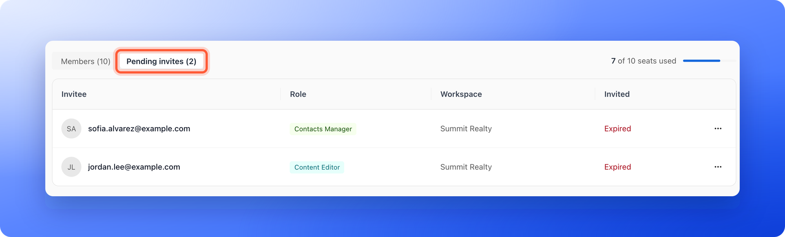
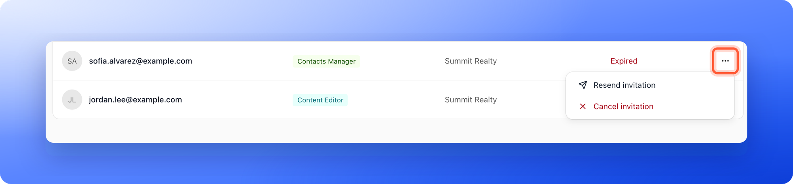
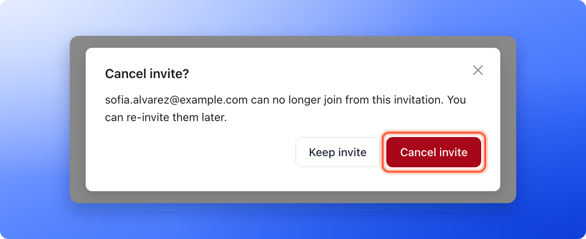

An invitation stays pending until the person accepts it. From the **Pending invites** tab you can send it again if they cannot find the email or the link ran out, or cancel it if you no longer want them to join.

**Before you start**, you need:

- An invitation that has not been accepted yet. See [Invite a teammate or client](/workspaces/give-access).
- To be a Global Admin, or a Workspace Admin of the workspace the invitation is for. An invitation for a Global Admin can only be changed by a Global Admin.

## Important to note

<Warning>
  - An invitation link works for 7 days. Resending sends a new link that works for 7 days from that moment, and the old link stops working.
  - A role that uses a team seat reserves the seat while the invitation is pending. Canceling frees it.
</Warning>

## Manage a pending invite

<Steps>
  <Step title="Open Pending invites">
    1. Click your name at the bottom of the sidebar, then click **"Members"**. On a phone, tap **"Menu"** at the bottom of the screen, then your name, then **"Members"**.
    2. Click the **Pending invites** tab next to **Members**. The number in brackets is how many invitations are waiting. The tab only shows while there is at least one.

    Workspace Admins: open your workspace, click **Settings** in the sidebar, then **Members**, then **Pending invites**.

    

    Each row shows the email, the role, the workspace and when it was invited. An invitation whose link has run out shows **Expired** instead of the date.
  </Step>
  <Step title="Resend or cancel">
    Click the **...** menu at the end of the row:

    - **Resend invitation:** Emails a new link. You see a message such as "Invitation resent to sofia.alvarez@example.com."
    - **Cancel invitation:** A window asks **Cancel invite?** and says the person can no longer join from this invitation and that you can re-invite them later. Click **"Cancel invite"** to confirm, or **"Keep invite"** to go back. You then see "Invitation to sofia.alvarez@example.com canceled."

    

    
  </Step>
</Steps>

## How do I know it is working?

- After a resend, the person receives a new email with a new link.
- After a cancel, the invitation leaves the list, its link stops working and the seat it reserved is free again. You can invite the person again later.
- When someone accepts, they move from **Pending invites** to the **Members** tab.

## Troubleshooting

<AccordionGroup>
  <Accordion title="Resend or Cancel shows an error">
    Only a Global Admin, or a Workspace Admin of the workspace the invitation is for, can resend or cancel it. Ask one of them to do it.
  </Accordion>
  <Accordion title="My teammate says the link is not valid">
    The invitation may have expired, been canceled or already been accepted. Check the **Members** tab, and if they are not there, use **"Resend invitation"** on the **Pending invites** tab.
  </Accordion>
  <Accordion title="I see that I sent too many invites in the last hour">
    The message says **You've sent too many invites in the last hour. Try again later.** AskFunnel limits how many invitations and resends you can send in an hour. Wait a little and try again.
  </Accordion>
  <Accordion title="I do not see a Pending invites tab">
    The tab only shows while an invitation is waiting. If everyone you invited has accepted, you see only **Members**.
  </Accordion>
</AccordionGroup>

## What to do next

<Columns cols={2}>
  <Card title="Invite a teammate or client" icon="envelope" href="/workspaces/give-access">
    Send a new invitation and choose a role.
  </Card>
  <Card title="Team seats" icon="users" href="/workspaces/team-seats">
    See which roles use a seat.
  </Card>
</Columns>

Need help? Email [support@askfunnel.com](mailto:support@askfunnel.com).
