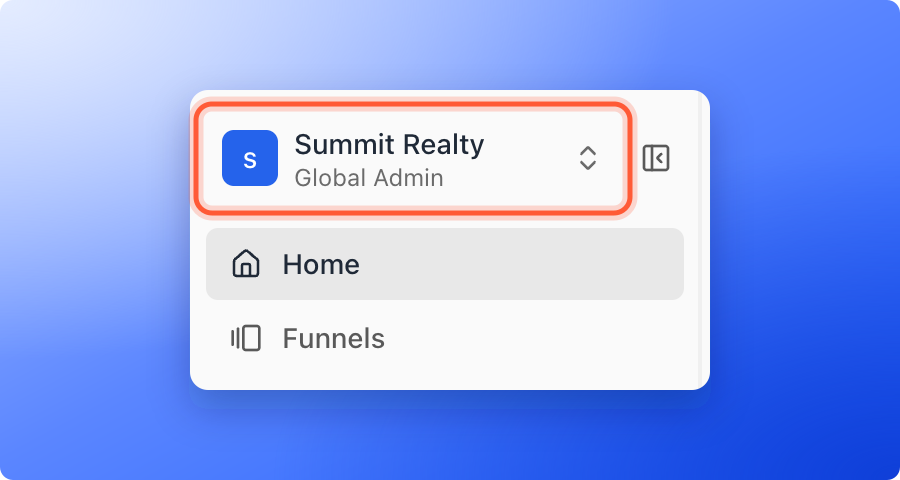
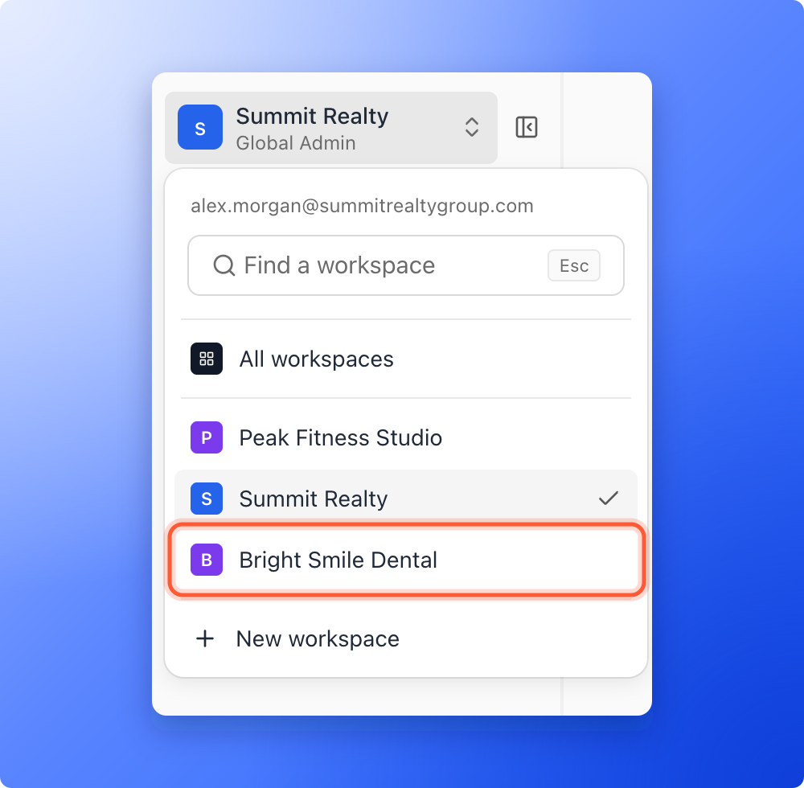

The workspace you are in is shown at the top of the sidebar on the left, with its icon, its name and your role in it. Click it to open another workspace.

## Open a workspace

<Steps>
  <Step title="Open the workspace switcher">
    Click the workspace name at the top of the sidebar. On a phone, tap the workspace name in the bar at the top of the screen. The switcher opens full screen.

    
  </Step>
  <Step title="Pick a workspace">
    A menu opens with your email address, a **Find a workspace** search box and the workspaces you can open. The one you are in has a check mark. Click the workspace you want. With many workspaces, type part of its name in the search box. If nothing matches, the list says **No workspace matches**. You land on that workspace's **Home**.

    
  </Step>
</Steps>

AskFunnel remembers the workspace you used last, so you come back to it the next time you sign in.

## See all your workspaces at once

Global Admins also see **All workspaces** at the top of the switcher menu. It opens a **Home** page that adds up every workspace and lists each one in a table with its leads, change, visitors and conversion rate, and how many live funnels it has. Click a row to open that workspace. See [Read your Home overview](/getting-started/home-overview).

## Which workspaces you see

Global Admins see every workspace. Everyone else sees only the workspaces they have been added to.

## Troubleshooting

<AccordionGroup>
  <Accordion title="I cannot find a workspace">
    You only see workspaces you have been added to. Ask a Global Admin to [add you to it](/workspaces/give-access).
  </Accordion>
  <Accordion title="I see a message that I have not been added to any workspaces">
    The page says **No workspaces yet** and **You haven't been added to any workspaces yet. Ask a Global Admin to invite you.** Your account is not in a workspace yet, so ask a Global Admin to invite you.
  </Accordion>
</AccordionGroup>

## What to do next

<Columns cols={2}>
  <Card title="Create a workspace" icon="folder-plus" href="/workspaces/create-workspace">
    Add a workspace for a new brand or client.
  </Card>
  <Card title="Invite a teammate or client" icon="envelope" href="/workspaces/give-access">
    Give someone access to a workspace.
  </Card>
</Columns>

Need help? Email [support@askfunnel.com](mailto:support@askfunnel.com).
